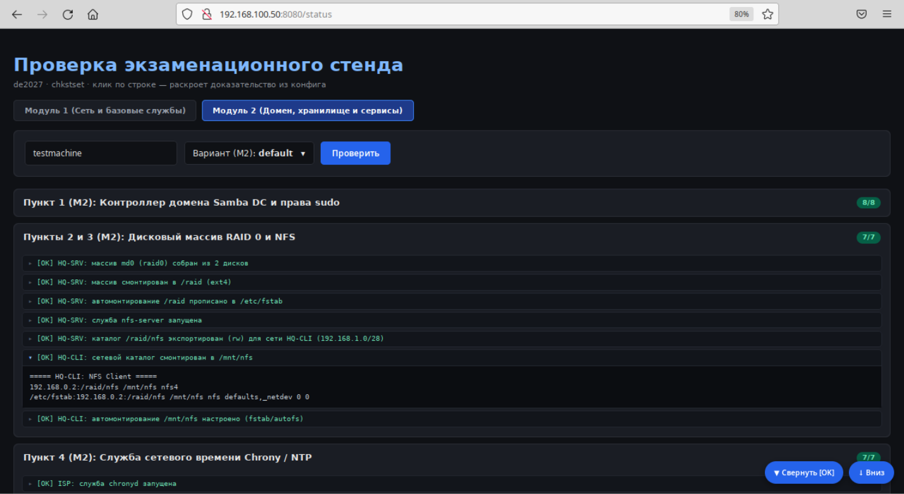

# pve-exam-checker

[Русский](README.md) | **English**

Modular Python tool for automated inspection and grading of **Proxmox VE** demonstration exam labs (`de2027`, Module 1 & Module 2) across **ALT Linux** and **EcoRouterOS** nodes, complete with a zero-dependency Web UI.



## Key Features

- **Safe Read-Only Inspection:** Does not require `root` access on hypervisor nodes (`PVE1`/`PVE2`).
  - **Linux Nodes (`ALT Linux`):** Inspected via Proxmox API (`qemu-guest-agent`). Standalone checks are executed in-memory via `base64` payloads and built-in `bash /dev/tcp` without pre-copying scripts onto student VMs.
  - **Routers (`EcoRouterOS`):** Temporarily attaches the isolated management interface (`vrf management`, `192.168.255.1/24`) via API per router, retrieves `show running-config` and `show users localdb` over SSH (`paramiko`), and guarantees `link_down=1` restoration in a `try...finally` block.
- **Customizable Exam Variants (`variants_m1/`, `variants_m2/`):** All variable exam parameters (subnet prefixes, usernames, UIDs, SSH/DNAT ports, DB credentials) are isolated into clean Python config files.
- **Built-in Web Interface (`web.py`):** Built purely on Python's standard library (`http.server`). Supports switching between Module 1 and Module 2, selecting and editing variant files directly in the browser, expandable config evidence per check, and full raw dump inspection.

## Structure

```text
pve-exam-checker/
├── config.example.py     # Proxmox VE API credentials template
├── web.py                # Zero-dependency Web UI (port 8080)
├── collector_m1.py       # Module 1 state collector
├── check_m1.py           # Module 1 CLI grader
├── variants_m1/          # Module 1 parameter variants (default.py, loader.py)
├── tasks_m1/             # Module 1 parser, check modules, and config evidence extractor
├── collector_m2.py       # Module 2 state collector
├── check_m2.py           # Module 2 CLI grader
├── variants_m2/          # Module 2 parameter variants (default.py, loader.py)
├── tasks_m2/             # Module 2 parser, check modules, and config evidence extractor
├── AGENTS.md             # Architecture & agent integration guide
├── LICENSE               # GNU GPL-3.0
├── README.md             # English documentation
└── README.ru.md          # Russian documentation
```

## Quick Start

### 1. Configuration
```bash
cp config.example.py config.py
chmod 600 config.py
# Edit config.py with your Proxmox VE host, API user, and password
```

Minimum required Proxmox VE privileges for the service account (`ExamChecker@pve`):
- `/vms`: `VM.Audit`, `VM.Monitor`, `VM.Config.Network`
- `/sdn`: `SDN.Use`
- `/pool`: `Pool.Audit`

### 2. CLI Usage
```bash
# Run full inspection & grading for Module 1
python3 check_m1.py <POOL_NAME> --variant default

# Run full inspection & grading for Module 2
python3 check_m2.py <POOL_NAME> --variant default

# Re-evaluate an already collected dump offline
python3 check_m1.py <POOL_NAME> --offline
python3 check_m2.py <POOL_NAME> --offline

# Verbose collection log (-v) or single-module run (--only)
python3 check_m1.py <POOL_NAME> -v --only p2
```

### 3. Web UI
```bash
python3 web.py
# Open http://<CHECKER_VM_IP>:8080 in your browser
```

## Disclaimer

This tool was created solely to automate educational lab assessment and demonstration exam grading in isolated training environments.

## License

Distributed under the **GNU General Public License v3.0 or later** (`GPL-3.0-or-later`). See `LICENSE` for details.
